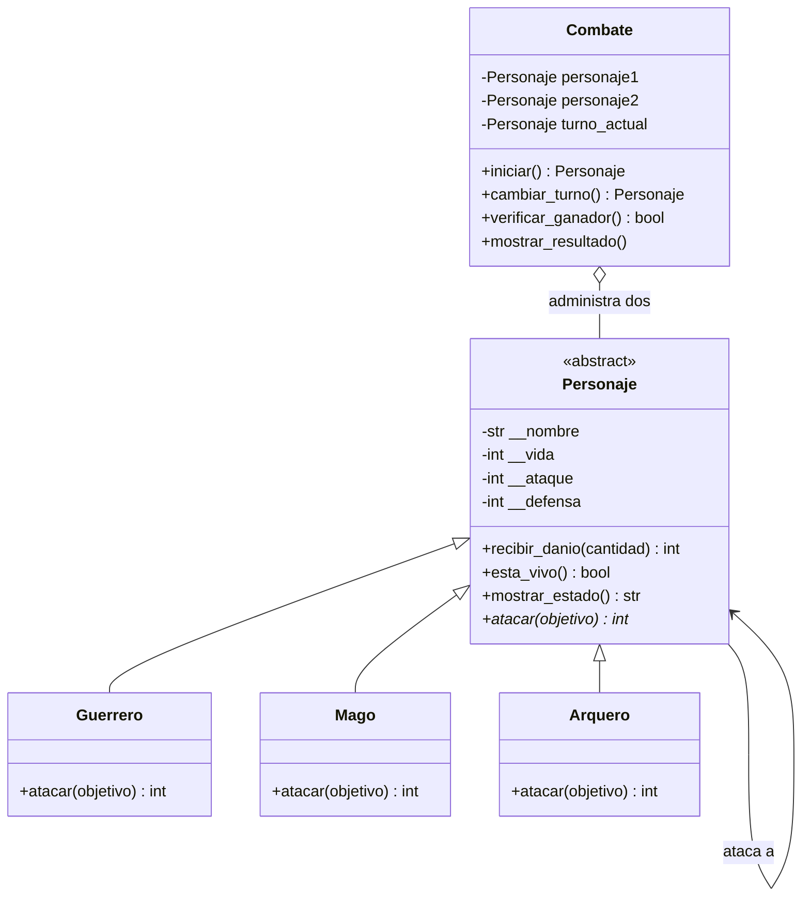

# Guardians of the Ancient Kingdom

Sistema de combate por turnos desarrollado en Python para practicar programación orientada a objetos.

## Descripción

El programa permite enfrentar dos guardianes, aplicar sus habilidades especiales, actualizar sus puntos de vida y determinar si existe un ganador o un empate.

## Estructura del proyecto

- `personajes.py`: contiene la clase abstracta `Personaje`, las clases `Guerrero`, `Mago` y `Arquero`, y la clase administradora `Combate`.
- `main.py`: demuestra las habilidades, las validaciones y un combate completo.
- `test_personajes.py`: contiene pruebas automatizadas con Pytest.

## Responsabilidad de las clases

- `Personaje`: centraliza los datos compartidos, valida sus valores, administra el daño recibido y define el método abstracto `atacar()`.
- `Guerrero`: aumenta el ataque un 20 %, resta la defensa del objetivo y redondea hacia abajo.
- `Mago`: causa un daño igual a su ataque e ignora la defensa.
- `Arquero`: duplica el daño base cuando su ataque supera la defensa del objetivo; de lo contrario, causa cero daño.
- `Combate`: alterna los turnos, muestra el estado de los participantes, identifica al ganador y controla los empates.

## Conceptos de POO

### Abstracción

`Personaje` es una clase abstracta creada con `ABC`. Define qué datos y operaciones tienen en común los guardianes sin imponer una única fórmula de ataque.

### Encapsulamiento

Los atributos se guardan como atributos privados (`__nombre`, `__vida`, `__ataque`, `__defensa`) y se accede a ellos mediante propiedades con validaciones. La vida no puede ser menor que cero ni mayor que 100.

### Herencia

`Guerrero`, `Mago` y `Arquero` heredan de `Personaje`, por lo que reutilizan sus atributos y métodos comunes.

### Polimorfismo

`Combate` llama a `atacar()` sin comprobar el tipo concreto del atacante. Cada subclase ejecuta su propia versión del método.

## Relaciones entre clases

- **Herencia:** las clases `Guerrero`, `Mago` y `Arquero` son tipos de `Personaje`.
- **Asociación:** cuando un personaje ataca a otro, ambos interactúan mediante `atacar()` y `recibir_danio()`.
- **Agregación:** `Combate` administra dos personajes que se crean antes e independientemente del combate.

## Diagrama de clases UML

El siguiente diagrama está escrito en Mermaid y puede visualizarse en un visor compatible con Mermaid.



La flecha de herencia indica que las tres clases concretas heredan de `Personaje`. El rombo vacío representa la agregación de personajes por parte de `Combate`; la asociación entre personajes representa la interacción durante un ataque.

## Lógica del combate

Cada ronda permite que cada participante ataque una vez, empezando por el primer personaje recibido por `Combate`. Después de cada ataque se muestran las vidas actuales. El combate termina cuando un personaje queda derrotado, cuando una ronda completa no causa daño o cuando se alcanzan 50 rondas.

El daño devuelto por `atacar()` corresponde al daño efectivamente recibido por el objetivo. Por eso, si un personaje tiene 8 puntos de vida y recibe un ataque de 20, el daño efectivo es 8 y su vida termina en cero.

## Reto de abstracción

`atacar()` es abstracto porque todos los personajes deben poder atacar, pero no todos calculan el daño de la misma forma. El Guerrero potencia su ataque, el Mago ignora la defensa y el Arquero puede duplicar el daño. La clase base declara esta operación y obliga a las subclases a implementarla; así, el combate puede invocar el mismo método y obtener un comportamiento distinto según el objeto, lo que demuestra polimorfismo.

En cambio, `recibir_danio()` puede estar implementado en `Personaje` porque todos los guardianes necesitan la misma lógica para validar el daño, reducir la vida y evitar que quede negativa. Centralizar esa operación evita repetir código y mantiene una regla común para todas las subclases.

## Ejecución

Se requiere Python 3.10 o posterior.

1. Descarga o clona el repositorio.
2. Abre la carpeta del proyecto en VS Code.
3. Ejecuta el programa:

```bash
python main.py
```

## Pruebas automatizadas con Pytest

Pytest permite ejecutar pruebas repetibles y verificar resultados automáticamente.

Instala Pytest:

```bash
python -m pip install pytest
```

Ejecuta las pruebas:

```bash
python -m pytest -v
```
